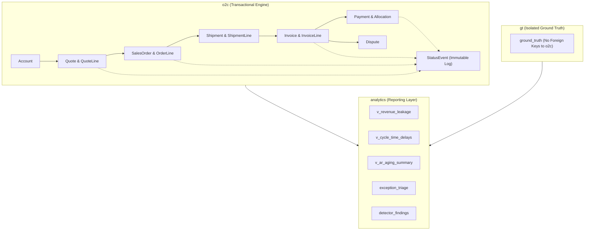

# Order-to-Cash (O2C) Revenue Leakage & Process Delay Tracker

A production-grade, enterprise-scale platform designed to monitor, track, and mitigate revenue leakage and process bottlenecks across the end-to-end Order-to-Cash lifecycle (**Quotes, Sales Orders, Fulfillment / Shipments, Invoices, Payments, Disputes, and Status Events**).

State transitions across all entities are captured as an immutable, append-only stream of status events (`o2c.status_event`), ensuring complete auditability, temporal integrity, and preventing historical overwrite.

---

## 1. System Architecture & Schemas

The database leverages PostgreSQL 15+ (Supabase) structured into three strictly isolated schemas:



### Schema Responsibilities:
1. **`o2c`**: Core operational domain. Holds 10 core entity tables, state transition sequence triggers, user profiles, and the migration registry (`o2c.migrations`).
2. **`gt`**: Synthetic ground-truth catalog (`gt.ground_truth`). Strictly isolated from `o2c` without foreign keys to prevent data leakage into operational logic.
3. **`analytics`**: Analytical views (`v_revenue_leakage`, `v_cycle_time_delays`, `v_ar_aging_summary`, `v_open_disputes_vs_receivables`, `v_unallocated_payments`) and triage tracking (`exception_triage`).

> [!IMPORTANT]
> **Supabase Table Editor Schema Dropdown**:
> All operational tables reside in custom schemas (`o2c`, `gt`, `analytics`). The Supabase Dashboard Table Editor defaults to the `public` schema. To inspect tables, switch the schema dropdown at the top-left of the Supabase Table Editor from `public` to `o2c`, `gt`, or `analytics`. Direct client access to these schemas is disabled via RLS and explicit privilege revocations (`has_table_privilege('anon') = false`).

---

## 2. Prerequisites & Toolchains

Ensure the following environments are installed:
- **Node.js**: `v20.0.0+` (`npm v10+`)
- **Python**: `3.11+`
- **PostgreSQL / Supabase**: Supabase cloud instance or PostgreSQL 15+
- **Google Chrome**: (Optional, for running headless browser walkthrough screenshot script)

---

## 3. Environment Configuration

Create a `.env` file in the project root based on `.env.example`:

```bash
cp .env.example .env
```

Configure your credentials in `.env`:
```ini
# Database & Supabase
DATABASE_URL=postgresql://postgres:[PASSWORD]@[HOST]:[PORT]/postgres
SUPABASE_URL=https://[PROJECT-REF].supabase.co
SUPABASE_ANON_KEY=[YOUR-ANON-KEY]
SUPABASE_SERVICE_ROLE_KEY=[YOUR-SERVICE-ROLE-KEY]

# Security & Sessions
JWT_SECRET=[SECURE-RANDOM-SECRET-AT-LEAST-32-CHARS]
DEMO_USER_PASSWORD=[SECURE-DEMO-PASSWORD]

# Pipeline Configuration
DATAGEN_SEED=20261022
DATAGEN_SCALE=full
API_PORT=4000
```

> [!NOTE]
> All credentials are read strictly from environment variables at startup. Zero fallback passwords or connection strings are hardcoded in source code or production bundles.

---

## 4. End-to-End Walkthrough & Setup Guide

### Step 1: Install Dependencies
Install all Node.js and Python packages:
```bash
# Node.js dependencies (API & Frontend)
npm install --prefix backend/api
npm install --prefix frontend

# Python dependencies (Pipeline & Generator)
pip install -e "backend/pipeline[dev]"
```

### Step 2: Run Database Migrations
Apply migrations `0001` through `0013` via the idempotent Python migration engine:
```bash
python -m pipeline.db.migrate
```
*Output confirms applied versions in `o2c.migrations` and prints the reminder to choose `o2c`/`gt`/`analytics` in the Supabase Table Editor.*

### Step 3: Provision Demo Role Users
Provision authentication accounts and role profiles in Supabase:
```bash
python scripts/create_demo_users.py
```
*Creates 5 demo persona accounts (`customer`, `sales_ops`, `support_agent`, `analyst`, `admin`) mapped into `o2c.profiles`.*

### Step 4: Synthetic Data Generation
Generate reproducible full-scale synthetic data (seed `20261022`):
```bash
# Generate baseline + injected edge cases (10k quotes, 7,010 orders, 8,049 invoices, 15,000 payments)
python -m pipeline.datagen generate --scale full --seed 20261022

# Validate referential integrity, enums, arithmetic, and date ordering
python -m pipeline.datagen validate

# Verify bit-for-bit reproducibility (runs twice, compares SHA-256 hashes)
python -m pipeline.datagen reproduce
```

### Step 5: Bulk Ingestion via PostgreSQL COPY
Stream the generated dataset into Supabase via high-throughput `COPY FROM STDIN`:
```bash
python -m pipeline.loader load --scale full
```

### Step 6: Execute Anomaly Detection & Evaluate Benchmark
Run all 10 anomaly detection rules and benchmark findings against `gt.ground_truth`:
```bash
# Run detector rules and persist findings to analytics.detector_findings
python -m pipeline.detector run

# Evaluate detection metrics (Precision, Recall, F1)
python -m pipeline.detector evaluate
```

### Step 7: Start Development Servers
Start both backend API and frontend dashboard:
```bash
# Terminal 1: Backend Fastify API (runs on http://localhost:4000)
npm run dev --prefix backend/api

# Terminal 2: Frontend React Dashboard (runs on http://localhost:5173)
npm run dev --prefix frontend
```

---

## 5. Primary Actors & Role-Based Access Control (RBAC)

The application enforces strict role-based access control across all 5 primary actors:

| Role | Demo Email | Access Scope & Permissions | Key UI / API Actions |
| :--- | :--- | :--- | :--- |
| **`customer`** | `customer@o2c-demo.com` | Scoped **strictly** to own `account_id` (`ACC-000001`). Forbidden from analytics and exceptions. | View own quotes, orders, invoices, payments. |
| **`sales_ops`** | `sales_ops@o2c-demo.com` | Access to records and `/analytics/*`. Forbidden from `/exceptions` (403). | Accept quotes (`POST /quotes/:id/accept`) and convert quotes to orders (`POST /quotes/:id/convert`). |
| **`support_agent`** | `support@o2c-demo.com` | Access to records and `/exceptions`. Forbidden from `/analytics/leakage` (403). | Triage exception findings (`POST /exceptions/:id/triage`) with notes and status. |
| **`analyst`** | `analyst@o2c-demo.com` | Full read access to records, `/analytics/*`, `/exceptions/*`, and `/exceptions/evaluation`. | Inspect leakage charts, AR aging buckets, delay metrics, and benchmark metrics. |
| **`admin`** | `admin@o2c-demo.com` | Unrestricted read/write access across all platform resources and user management. | Manage user roles (`GET` / `PATCH /api/v1/admin/users/:id/role`), view debug health. |

### Testing Role-Guards via cURL:
```bash
# Authenticate as Customer
curl -X POST http://localhost:4000/api/v1/auth/login \
  -H "Content-Type: application/json" \
  -d '{"email":"customer@o2c-demo.com","password":"'$DEMO_USER_PASSWORD'"}' -c cookie.txt

# Attempt to access Leakage Analytics (Blocked with HTTP 403 Forbidden):
curl http://localhost:4000/api/v1/analytics/leakage -b cookie.txt

# Authenticate as Analyst
curl -X POST http://localhost:4000/api/v1/auth/login \
  -H "Content-Type: application/json" \
  -d '{"email":"analyst@o2c-demo.com","password":"'$DEMO_USER_PASSWORD'"}' -c cookie.txt

# Access Leakage Analytics (Allowed with HTTP 200 OK):
curl http://localhost:4000/api/v1/analytics/leakage -b cookie.txt
```

#if you want to create personalised account and password:
# Create an Analyst account:
python scripts/create_demo_users.py --email "myuser@example.com" --password "MyPassword123!" --role "analyst" --name "My Full Name"

# Or create an Admin account:
python scripts/create_demo_users.py --email "superadmin@example.com" --password "SecurePass2026!" --role "admin" --name "Super Admin"

# Or create a Customer account:
python scripts/create_demo_users.py --email "client@company.com" --password "CustomerPass123!" --role "customer" --name "Client Account"

---

## 6. Monitored Anomaly Rules & Benchmark Results

The anomaly detector was evaluated across the full operational scale against 588 ground truth items (`gt.ground_truth`):

| Issue Type | Target Entity | Injected Rule Code | Expected Decision | Precision | Recall | F1 Score |
| :--- | :--- | :--- | :--- | :---: | :---: | :---: |
| **`CREDIT_LIMIT_EXCEEDED`** | `SALES_ORDER` | `RULE-07-CREDIT-LIMIT` | `HOLD_ORDER_CREDIT_REVIEW` | 100.0% | 100.0% | **100.0%** |
| **`DISPUTE_NOT_IN_RECEIVABLES`**| `DISPUTE` | `RULE-05-DISPUTE-NOT-IN-RECEIVABLES` | `REJECT_DISPUTE_PAID_INVOICE` | 100.0% | 100.0% | **100.0%** |
| **`INVOICE_EXCEEDS_FULFILLED`** | `INVOICE_LINE` | `RULE-01-EXCEEDS-FULFILLED` | `FLAG_OVERBILLING_HOLD` | 100.0% | 100.0% | **100.0%** |
| **`INVOICE_NOT_IN_AR_AGING`** | `INVOICE` | `RULE-08-NOT-IN-AGING` | `SYNC_INVOICE_TO_AGING` | 100.0% | 100.0% | **100.0%** |
| **`LONG_OVERDUE_INVOICE`** | `INVOICE` | `RULE-10-LONG-OVERDUE` | `ESCALATE_TO_COLLECTIONS` | 100.0% | 100.0% | **100.0%** |
| **`LATE_PAYMENT`** | `PAYMENT` | `RULE-09-LATE-PAYMENT` | `ASSESS_LATE_FEE` | 100.0% | 100.0% | **100.0%** |
| **`PARTIAL_SHIPMENT`** | `SHIPMENT_LINE` | `RULE-06-PARTIAL-SHIPMENT` | `SCHEDULE_BACKORDER_FULFILLMENT`| 100.0% | 100.0% | **100.0%** |
| **`PROLONGED_ORDER_TO_SHIP`** | `SALES_ORDER` | `RULE-03-PROLONGED-FULFILLMENT`| `EXPEDITE_ORDER_FULFILLMENT` | 100.0% | 100.0% | **100.0%** |
| **`SLOW_PAYMENT_APPLICATION`** | `PAYMENT` | `RULE-04-SLOW-APPLICATION` | `ACCELERATE_CASH_APPLICATION` | 100.0% | 100.0% | **100.0%** |
| **`UNALLOCATED_PAYMENT`** | `PAYMENT` | `RULE-02-UNALLOCATED-PAYMENT` | `APPLY_REMAINING_CASH` | 100.0% | 100.0% | **100.0%** |
| **OVERALL (MACRO)** | — | — | — | **100.0%** | **100.0%** | **100.0%** |

---

## 7. Verification Test Suites

Execute the automated test suites to verify system integrity:

```bash
# 1. Python Pipeline Tests (13 tests: DB constraints, views, data dictionary, reproducibility)
$env:PYTHONPATH="backend/pipeline/src"; python -m pytest backend/pipeline/tests -v

# 2. Python Ruff Lint Check
python -m ruff check backend/pipeline/src

# 3. Fastify Backend API Tests (20 tests: health, request ID, error envelope, triage, convert, admin)
npm test --prefix backend/api -- --run

# 4. React Frontend Tests (13 tests: sessionStore, apiClient, route guards, components)
npm test --prefix frontend -- --run

# 5. Full 50-Route Direct & Vite Proxy Smoke Test
python scripts/smoke_test.py

# 6. Customer Scoping Isolation & 10,000 Quote Cursor Pagination Test
python scripts/verify_scoping_and_pagination.py

# 7. System Doctor Health Check
python scripts/doctor.py

# 8. Automated Headless Browser Walkthrough & Screenshot Capture (Optional)
node scripts/browser_walkthrough.cjs
```

---

## 8. Coding Standards & Architectural Invariants

All source files adhere to the following strict production standards:
1. **Contract Docstrings**: Every function begins with a standardized 4-line docstring:
   - `PURPOSE`: Exact single-line summary of function responsibility.
   - `INPUT`: Accepted schema (Zod schema, Pydantic model, typed params).
   - `RETURNS`: Return type and shape.
   - `ERRORS`: Explicit list of raised exceptions or error codes.
2. **Lean Files & Functions**:
   - Every source file is strictly $\le 150$ lines.
   - Functions are modular and $\le 25$ lines.
3. **Strict Boundaries & Typing**:
   - Zero `any` types in TypeScript; strict mode enabled.
   - Zod validation on every API request and response boundary.
   - Pydantic validation across all Python data structures.
4. **Standard API Response Envelope**:
   - Every API endpoint returns `{ ok: boolean, data?: T, error?: { code: string, message: string } }`.
5. **Zero Hardcoded Secrets**:
   - All connection strings, JWT secrets, and demo passwords are read strictly from `.env` at runtime.

---

## 9. Project Documentation Index

- [Architecture & System Design](docs/architecture.md)
- [Entity-Relationship Diagram (ERD)](docs/erd.md)
- [Data Dictionary (6 Required Columns)](docs/data-dictionary.md)
- [Metrics & Formulas Reference](docs/metrics.md)
- [Requirements Traceability Matrix](docs/requirements-traceability.md)
- [Live Demo Script (5 Personas)](docs/demo-script.md)
- [Validation Summary Report](docs/validation-summary.md)
- [Known Limitations & Trade-offs](docs/known-limitations.md)
