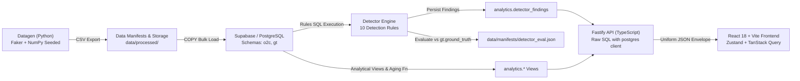

# System Architecture & Design Specification

## Overview

The **Order-to-Cash (O2C) Revenue Leakage & Process Delay Tracker** is an enterprise data and analytics platform designed to continuously audit, detect, and evaluate anomalies, margin leakage, and process bottlenecks across the commercial transaction graph.

---

## 1. End-to-End Pipeline Flow



1. **Synthetic Data Generator (`backend/pipeline/src/pipeline/datagen`)**:
   - Seeded, deterministic generation across master entities (`account`, `quote`, `sales_order`) and transactions (`shipment`, `invoice`, `payment`, `dispute`, `status_event`).
   - Clean baseline data generation followed by controlled anomaly injection with labels saved to `gt.ground_truth`.
2. **Database Loader (`backend/pipeline/src/pipeline/loader.py`)**:
   - High-throughput ingestion using PostgreSQL `COPY` inside transactions with `session_replication_role = replica`.
3. **Anomaly Detector (`backend/pipeline/src/pipeline/detector`)**:
   - Discrete rules running SQL queries against operational tables (`o2c.*`).
   - Persists findings to `analytics.detector_findings` and evaluates against `gt.ground_truth`.
4. **Analytical SQL Layer (`backend/db/migrations/0010_analytics_views.sql`)**:
   - Parameterized aging function `analytics.fn_aging(p_cutoff DATE)`.
   - Production views: `v_revenue_leakage`, `v_cycle_time_delays`, `v_unallocated_payments`, `v_open_disputes_vs_receivables`.
5. **Backend API (`backend/api`)**:
   - Fastify API using `postgres` client (tagged template literals, zero ORM).
   - `@supabase/supabase-js` restricted to `src/modules/auth/service.ts` for credential verification only.
   - Issues signed 8h JWTs in httpOnly, SameSite=Lax cookies (`o2c_session`).
6. **Frontend (`frontend`)**:
   - React 18, Vite, TypeScript strict, TanStack Query, Zustand, Recharts, Tailwind CSS. Zero Supabase SDK in browser.

---

## 2. Role-Based Access Control (RBAC) Matrix

| Role | Operational Records (`/records/:entity`) | Summary (`/analytics/summary`) | Aging & Delays (`/analytics/*`) | Leakage (`/analytics/leakage`) | Exceptions (`/exceptions`) | Evaluation (`/exceptions/evaluation`) |
| :--- | :--- | :--- | :--- | :--- | :--- | :--- |
| **`customer`** | Own account only | Forbidden (403) | Forbidden (403) | Forbidden (403) | Forbidden (403) | Forbidden (403) |
| **`sales_ops`** | Full read | Allowed (200) | Allowed (200) | Allowed (200) | Forbidden (403) | Forbidden (403) |
| **`support_agent`** | Full read | Allowed (200) | Allowed (200) | Forbidden (403) | Allowed (200) | Forbidden (403) |
| **`analyst`** | Full read | Allowed (200) | Allowed (200) | Allowed (200) | Allowed (200) | Allowed (200) |
| **`admin`** | Full read | Allowed (200) | Allowed (200) | Allowed (200) | Allowed (200) | Allowed (200) |

---

## 3. Uniform API Response Envelope Specification

Every endpoint returns a standard JSON envelope:

### Success Response
```json
{
  "ok": true,
  "data": { ... }
}
```

### Error Response
```json
{
  "ok": false,
  "error": {
    "code": "FORBIDDEN",
    "message": "Forbidden: insufficient permissions"
  }
}
```
