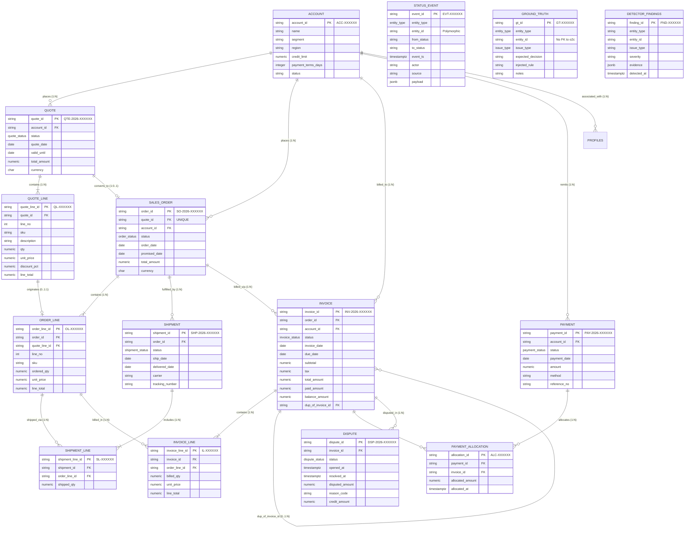

# Entity Relationship Diagram (ERD) & Cardinality

This document outlines the data model and structural relationships across schemas `o2c`, `gt`, and `analytics`.

## Mermaid Entity Relationship Diagram

---

## Cardinality & Relationship Matrix

| Primary Entity | Foreign / Child Entity | Cardinality | Enforced Constraints | Description |
| :--- | :--- | :--- | :--- | :--- |
| `o2c.account` | `o2c.quote` | `1 : 0..N` | `ON DELETE RESTRICT` | Customer accounts request multiple quotes |
| `o2c.account` | `o2c.sales_order` | `1 : 0..N` | `ON DELETE RESTRICT` | Customer accounts can place multiple sales orders |
| `o2c.quote` | `o2c.quote_line` | `1 : 1..N` | `ON DELETE RESTRICT`, `UNIQUE(quote_id, line_no)` | Each quote consists of multiple line items |
| `o2c.quote` | `o2c.sales_order` | `1 : 0..1` | `quote_id UNIQUE` on `sales_order` | A quote converts into at most one sales order |
| `o2c.sales_order` | `o2c.order_line` | `1 : 1..N` | `ON DELETE RESTRICT`, `UNIQUE(order_id, line_no)` | Each sales order consists of multiple order lines |
| `o2c.order_line` | `o2c.quote_line` | `0..N : 0..1`| `ON DELETE RESTRICT` | Order lines originate from corresponding quote lines |
| `o2c.sales_order` | `o2c.shipment` | `1 : 0..N` | `ON DELETE RESTRICT` | An order may be fulfilled in partial or multiple shipments |
| `o2c.shipment` | `o2c.shipment_line` | `1 : 1..N` | `ON DELETE RESTRICT`, `UNIQUE(shipment_id, order_line_id)` | Shipment contains fulfillment quantities for lines |
| `o2c.sales_order` | `o2c.invoice` | `1 : 0..N` | `ON DELETE RESTRICT` | Orders can have milestone, partial, or full invoices |
| `o2c.invoice` | `o2c.invoice_line` | `1 : 1..N` | `ON DELETE RESTRICT` | Invoices itemize billed quantities and prices |
| `o2c.invoice` | `o2c.invoice` | `0..1 : 0..N`| `dup_of_invoice_id` | Self-reference pointing to the primary invoice |
| `o2c.account` | `o2c.payment` | `1 : 0..N` | `ON DELETE RESTRICT` | Accounts remit cash receipts |
| `o2c.payment` | `o2c.payment_allocation` | `1 : 1..N` | `ON DELETE RESTRICT` | Single payments may be split across multiple invoices |
| `o2c.invoice` | `o2c.payment_allocation` | `1 : 0..N` | `ON DELETE RESTRICT` | An invoice can be paid off across multiple allocations |
| `o2c.invoice` | `o2c.dispute` | `1 : 0..N` | `ON DELETE RESTRICT` | Invoices can receive one or more customer disputes |
| Operational Tables | `o2c.status_event` | `1 : 0..N` | Immutable ledger, trigger-maintained | Capture all historical state transitions |
| N/A | `gt.ground_truth` | Isolated | **Zero FKs to `o2c` schema** | Benchmark evaluation without feature leakage |
| Detector Rules | `analytics.detector_findings` | N/A | Dedicated findings table | Output of discrete detection rule executions |
